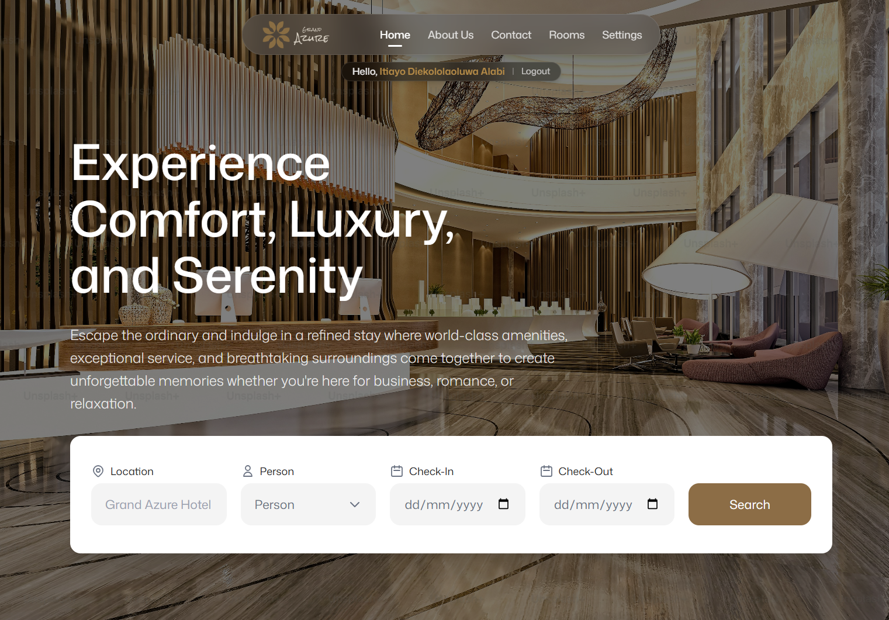
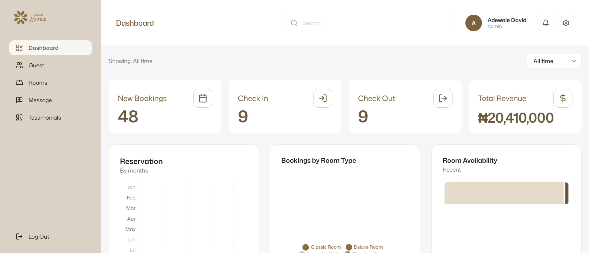
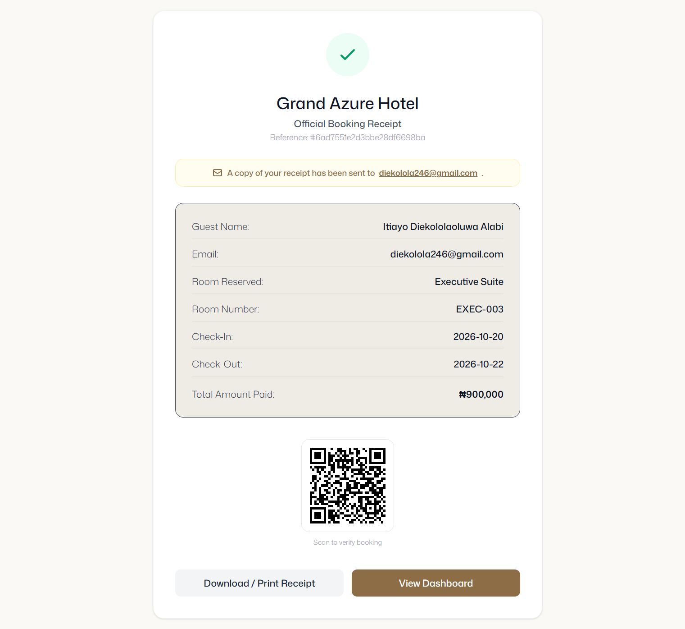
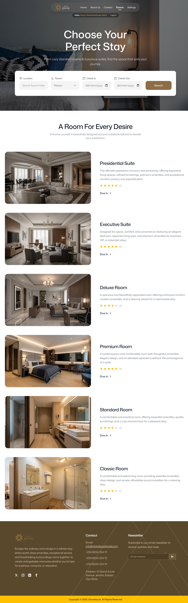
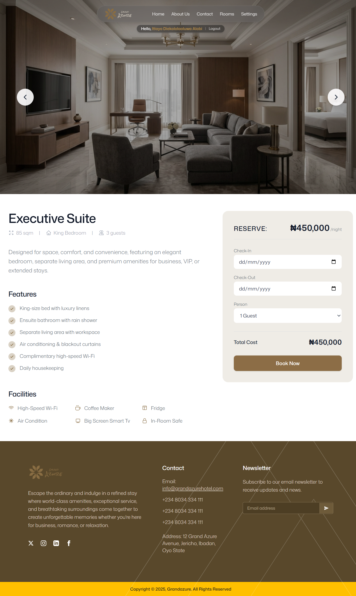
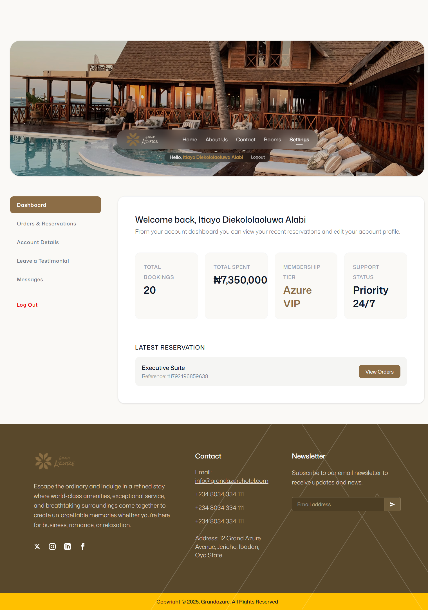
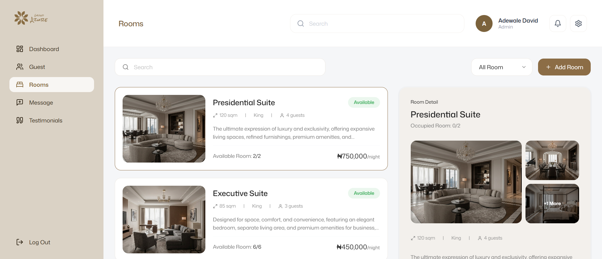

# Grand Azure Hotel

A full-stack hotel booking platform. Guests can browse rooms, check availability, book and pay online, and manage their reservations. Staff get a separate admin dashboard for bookings, rooms, messages and daily operations.

**Live site:** https://grandazure.vercel.app
**API:** https://azure-hotel-management-system.onrender.com


---

## Screenshots

### Guest side

| Home | Admin Dashboard |
| --- | --- |
|  |  |

| Booking Success | Rooms |
| --- | --- |
|  |  |

| Room Details | Settings |
| --- | --- |
|  |  |

### Admin side

| Admin Rooms |
| --- |
|  |

---

## Features

### Guest side
- Browse room types with images, price, capacity, bed type, size, features, facilities and live star ratings
- Rooms are listed from most to least expensive
- Search availability by check-in date, check-out date and number of guests
- Guest checkout (no account needed) or book while logged in, with details prefilled from your account
- Payment with Paystack in test mode. A notice explains that no real money is involved, with a longer warning for totals above the test limit
- Payment is verified on the server before a booking is confirmed
- Automatic assignment of a free physical room for the chosen dates
- Booking receipt with room number and a QR code that opens a booking verification page
- Sign up and log in with email and password, or with Google
- Forgot password and reset password through an emailed link
- Account area: dashboard stats, reservation history with live status, cancel a booking, edit profile and password
- Rate a stay and leave a testimonial (testimonials are approved by an admin before they appear publicly)
- Message the front desk from the account area
- Contact form and newsletter signup with a confirmation email

### Admin side
- Role-protected admin area. Admins are sent straight to the dashboard after login
- Dashboard with a date range filter (today, 3 days, 7 days, 30 days, all time) that refreshes automatically
- Stats for new bookings, check-ins, check-outs and revenue, plus charts for reservations by month, bookings by room type and room availability
- Guests page: search, filter by status and date range, paginate, and move bookings through confirmed, checked-in and checked-out, or cancel them
- Rooms page: add, edit and delete room types. Creating a room type generates its physical rooms from a prefix and a count (for example `DLX-001` to `DLX-014`)
- Manage individual physical rooms: add, remove, and set available, occupied or maintenance
- Reply to guest messages
- Approve or delete testimonials
- Shared team task board
- Notifications for new messages and tasks

---

## How bookings and rooms work

**Booking status:** `confirmed` to `checked-in` to `checked-out`. A booking can also be `cancelled` before check-in, or `no-show`.

- A paid booking starts as `confirmed`.
- Staff check guests in and out manually from the Guests page.
- If a confirmed booking's check-in day passes with no check-in, it is marked `no-show`.
- If a checked-in guest passes their checkout date, they are flagged **Overdue**. They are not checked out automatically, because only staff can confirm the guest has actually left.

**Room availability** is worked out per day, not with a permanent flag. A room is free for a date range if no active booking overlaps it, so a room booked for next week can still be booked for other dates.

**Room status buckets** on the dashboard always add up to the total number of physical rooms:

| Status | Meaning |
| --- | --- |
| Occupied | A guest has been checked in |
| Reserved | Empty today, but a confirmed booking covers today and the guest has not been checked in |
| Available | Empty and no booking covers today |
| Not available | Marked as under maintenance by an admin |

---

## Tech stack

**Frontend:** React, Vite, Tailwind CSS, React Router, Axios, Recharts, React Icons, react-paystack, @react-oauth/google

**Backend:** Node.js, Express, MongoDB with Mongoose, JSON Web Tokens, bcryptjs, google-auth-library, Axios

**Services:** Paystack (payments), Brevo (transactional email), Cloudinary (hosted room images), Google Identity (sign-in)

**Hosting:** Vercel (frontend), Render (backend)

---

## Project structure

```
backend/
  Controllers/    request handling and business logic
  Database/       db connection and seed scripts
  Middleware/     verifyToken, optionalAuth, verifyAdmin
  Models/         Mongoose schemas
  Routes/         Express routers
  Utils/          email helper
  index.js

frontend/src/
  components/     shared UI (and components/admin)
  context/        AuthContext
  pages/          customer pages (and pages/admin)
  App.jsx         routes
```

---

## Getting started

### Prerequisites
- Node.js 18 or newer
- A MongoDB database (local or Atlas)
- Paystack test keys
- A Brevo account with a verified sender email and an API key
- A Google OAuth client ID (for Google sign-in)

### 1. Clone

```bash
git clone https://github.com/Itiayooo/Azure-Hotel-Management-System
cd Azure-Hotel-Management-System
```

### 2. Backend

```bash
cd backend
npm install
```

Create a `.env` file:

```
MONGO_URI=your_mongodb_connection_string
JWT_SECRET=a_long_random_string
PAYSTACK_SECRET_KEY=sk_test_xxx
BREVO_API_KEY=your_brevo_api_key
BREVO_SENDER_EMAIL=the_sender_address_you_verified_in_brevo
GOOGLE_CLIENT_ID=your_google_oauth_client_id
```

Use the variable name your `db.connect.js` reads for the database URL.

Seed the database. Both scripts clear their collections first, so only run them on a fresh or disposable database:

```bash
node Database/db.script.js          # room types
node Database/physicalRoom.seed.js  # physical rooms
node index.js                       # runs on port 8006
```

### 3. Frontend

```bash
cd frontend
npm install
```

Create a `.env` file:

```
VITE_PAYSTACK_PUBLIC_KEY=pk_test_xxx
```

Set your Google client ID in the `GoogleOAuthProvider` in `main.jsx`. Several pages call the API by its full URL. To run against a local backend, search the frontend for `azure-hotel-management-system.onrender.com` and replace it with `http://localhost:8006`. Then run:

```bash
npm run dev
```

### 4. Create an admin account

Register a normal account, then change its `role` from `customer` to `admin` in your database. Log in again so your token carries the admin role.

---

## API overview

| Area | Endpoints |
| --- | --- |
| Auth | `POST /api/auth/register`, `/login`, `/google`, `/forgot-password`, `/reset-password` |
| Users | `PUT /api/users/profile` |
| Rooms | `GET /api/rooms`, `GET /api/rooms/available`, `GET /api/rooms/:id`; admin: `POST`, `PUT /:id`, `DELETE /:id` |
| Physical rooms | `/api/physical-rooms` CRUD and `PATCH /:id/status` (admin) |
| Bookings | `POST /api/bookings`, `GET /my`, `GET /:id`, `GET /verify/:reference`, `PATCH /:id/cancel`, `POST /send-receipt-email`; admin: `GET /`, `PATCH /:id/confirm`, `/check-in`, `/check-out` |
| Reviews | `POST /api/reviews`, `GET /api/reviews/room/:roomId` |
| Testimonials | `GET /api/testimonials`, `POST`; admin: `GET /all`, `PATCH /:id/approve`, `DELETE /:id` |
| Messages | customer: `GET /my`, `POST /`; admin: `GET /threads`, `GET /thread/:customerId`, `POST /:customerId/reply` |
| Tasks | `/api/tasks` (admin) |
| Admin | `GET /api/admin/dashboard-stats?range=today|3d|7d|30d|all`, `GET /booking-stats`, `GET /notifications`, `POST /reconcile-rooms` |
| Other | `POST /api/contact`, `POST /api/subscribers` |

Protected routes expect an `Authorization: Bearer <token>` header.

---

## Known limitations

- Payments run in Paystack test mode, and test transactions above about ₦500,000 can fail
- Apple sign-in is not implemented (it needs a paid Apple Developer account)
- Room images are added by URL rather than uploaded from the admin panel
- Sessions are stored in `localStorage`, so logging in as a different user in another tab replaces the session in every tab
- Guests without an account manage their bookings by contacting the hotel
- The Brevo free plan allows 300 emails per day

---

## Author

Built by Itiayo

## License

Personal portfolio project.
